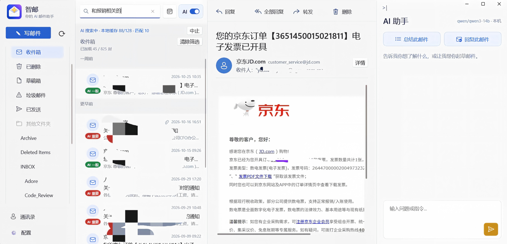
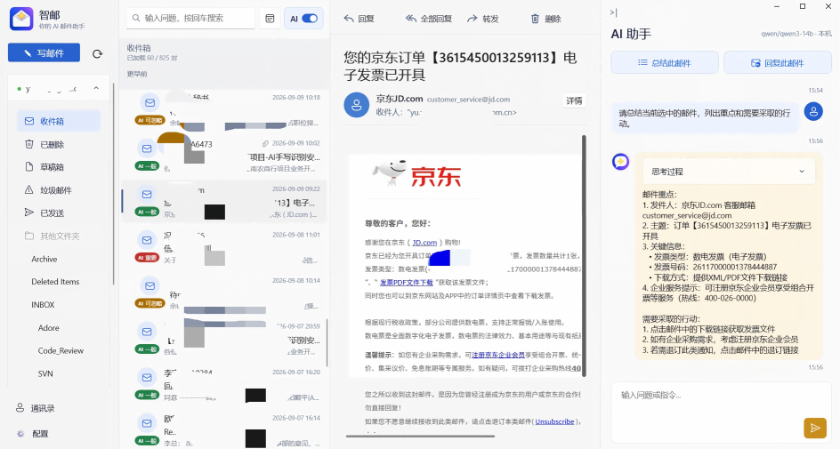
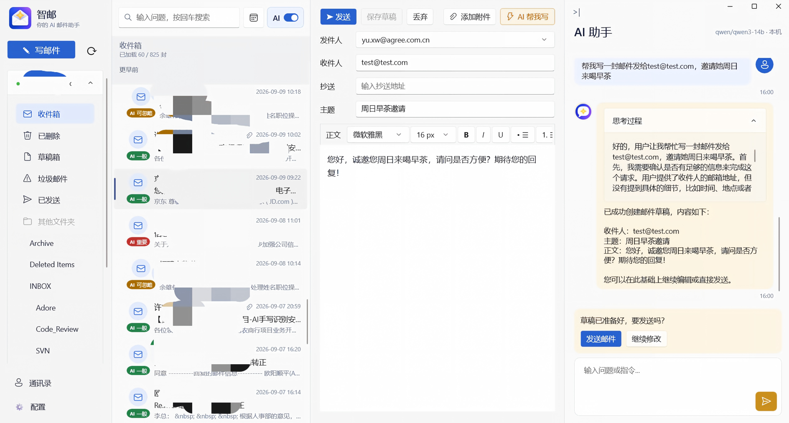
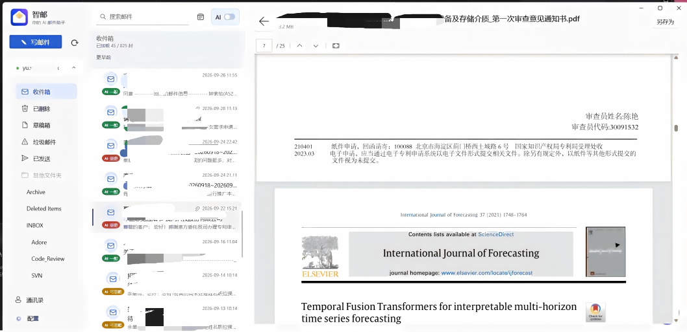

# MailMind

**An AI agent-powered Windows email client for understanding, searching, and writing mail locally.**

English | [简体中文](README.zh-CN.md)

MailMind is an email client powered by a local AI agent. It can assess email importance in the context of your role, find messages using natural language, understand the message you are reading, and help draft replies. With local models, AI inference for business email can run entirely on your own computer, without sending message contents to a cloud AI service.

> Sending and receiving mail still requires a connection to your email provider. Protect your device, credentials, and local cache, and review AI classifications and drafts.

## Screenshots

| | |
| --- | --- |
|  |  |
| AI search | AI summary |
|  |  |
| AI writing | Attachment preview |

## AI Features

- **Importance labels:** Classify messages as important, normal, or ignorable using the sender, subject, preview, and your personal profile.
- **Natural-language AI search:** Find messages by meaning and related expressions, rather than exact keywords alone. Results are limited by which messages have been loaded and can be read.
- **AI email assistant:** Summarize the selected message, identify key points and actions, search locally cached messages, read mail, and look up contacts through conversation.
- **Writing assistance:** Create or edit drafts from your instructions, or generate a reply to the current message. Review drafts before sending; the assistant does not send mail on its own.
- **Local AI:** Models run on your computer and MailMind calls the model service through `127.0.0.1`. You choose and control the models and runtime.
- **MCP tools:** Connect local agents such as WorkBuddy to search mail and contacts and work with drafts through MCP over stdio.

## Configure Local AI

MailMind uses two kinds of models from the same local model service:

| Model | Purpose | Recommendation |
| --- | --- | --- |
| SystemOne decision model | Importance labels and AI search | Try `cloudflare-clev-flash-` with a local service that supports `/v1/systemone`. |
| Completion model | Email drafting, summaries, and the AI assistant | Try Qwen3-14B; use a quantized version if memory is limited. |

Quality and speed depend on your hardware, quantization, and model capabilities. A general chat model does not necessarily support SystemOne, and an OpenAI-compatible chat endpoint alone is insufficient for decision features. Verify that your service exposes `/v1/systemone` and `/v1/chat/completions` and lists models with `decision` and `llm`/`vlm` types respectively.

1. Install and start LM Studio or Lemonade Server locally. Prepare a decision model and a generation model supported by the required endpoints, then start the service.
2. Open **Configuration** in MailMind and go to AI settings. Select the service and enter its port (default: `1234` for LM Studio, `13305` for Lemonade Server).
3. Refresh the model list, select a decision model and a generation model, enter a personal profile, enable AI classification, and save.
4. If a model is missing, check that the service is running, the port and APIs are compatible, and the service recognizes the model.

## Connect an MCP Agent

MailMind exposes its assistant tools to local MCP clients over stdio. Start MailMind and sign in to your account, then add the following to your agent's MCP configuration (the configuration file and top-level keys depend on the client):

```json
{
  "mcpServers": {
    "mailmind": {
      "command": "C:\\path\\to\\MailMind.exe",
      "args": ["--mcp-stdio"]
    }
  }
}
```

Replace `command` with the actual absolute path to `MailMind.exe`. The MCP client starts a separate stdio process, which connects to the running MailMind window through a local pipe restricted to the current Windows user. Restart the MCP service after restarting MailMind. The built-in assistant uses the same tool handler through the local pipe.

Tools can search cached mail, read the selected message, manage contacts, and create or update drafts. Mail deletion requires confirmation in MailMind; sending remains a user action. Current-mail and draft tools use the state of the open window. The service can access private mail and modify contacts and drafts, so connect only trusted agents; other processes under the same Windows user can also access the pipe.

When rebuilding or redeploying a debug package, stop both MailMind and any MCP client services using its executable so they release the application files. See [MCP stdio details](docs/mcp-stdio.md).

## Attachments and Email

Preview attachments directly in MailMind or save them to your device. Available preview formats depend on the types allowed by the app and the Windows preview handlers installed on your system.

MailMind also supports IMAP browsing, SMTP sending, folders, contacts, date filtering, and a local SQLite cache. Cached content remains available when the connection fails; initial loading requires a connection.

## Getting Started

- Windows 11 (build 22000) or later, as required by the packaging project's minimum target version.
- Visual Studio with .NET desktop and Windows application development components and the Windows SDK; .NET 8 SDK.
- An email account with IMAP and SMTP access and any password or app authorization code required by your provider.

Open `MailMind.slnx` in Visual Studio, restore NuGet packages, select the platform matching your device, and run the app. Open **Configuration**, enter your IMAP and SMTP settings, and save. Configure AI separately using the steps above.

Account configuration, AI settings, and the mail cache are stored under `%LOCALAPPDATA%\MailMind`. Mail passwords or authorization codes are stored in Windows Credential Manager. The cache can contain message bodies and attachments, so protect your device and backups.

## Roadmap

- **Ollama support:** Add support for running local models with Ollama.
- **Skill support:** Extend the AI assistant with skills so it can handle more tasks.
- **System tray and notifications:** Show Windows notifications for important messages, change only the tray icon for normal messages, and leave ignorable messages silent.

## License

MailMind is open source under the [MIT License](LICENSE).
