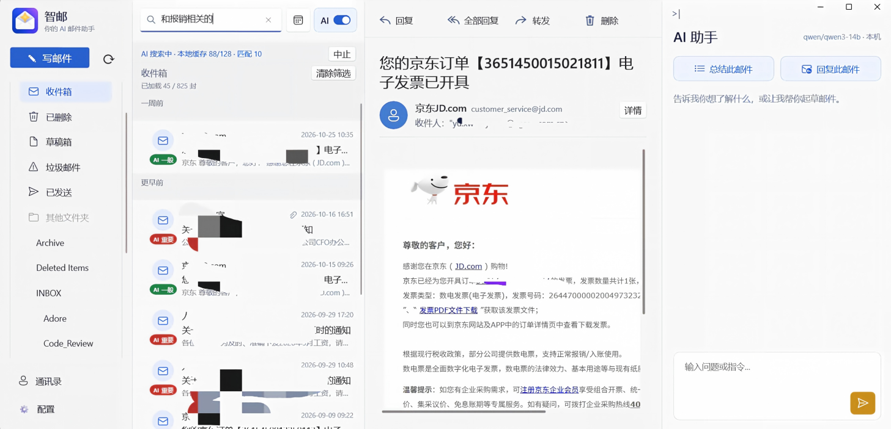
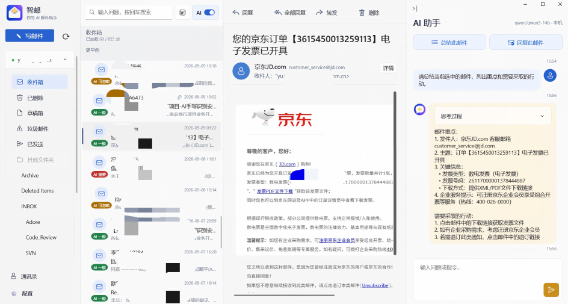
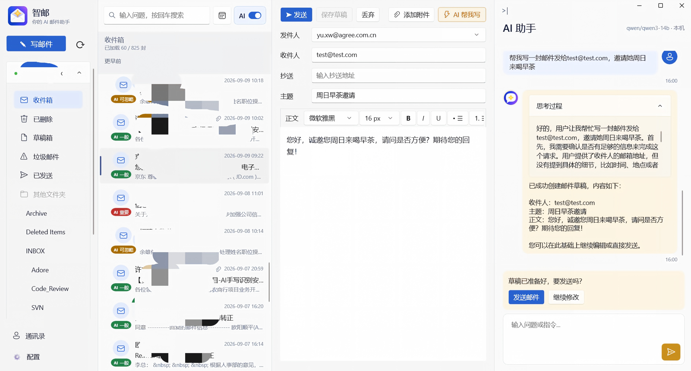
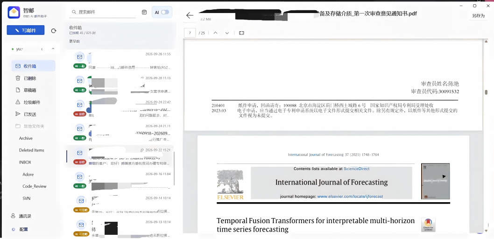

# MailMind 智邮

**由 AI Agent 驱动的 Windows 邮箱客户端，让邮件理解、搜索与写作在本机完成。**

[English](README.md) | 简体中文

MailMind 是一款基于本地 AI Agent 驱动的邮箱客户端。它可以根据你的角色判断邮件的重要性，用自然语言查找邮件，理解当前邮件并协助起草回复。连接本地模型后，商业邮件的 AI 推理可以完全在你的电脑上进行，无需将邮件内容发送给云端 AI 服务。

> 邮件收发仍需连接你的邮箱服务商。请保护本机、邮箱凭据和本地缓存；AI 的判断和草稿也应由你检查。

## 界面展示

| | |
| --- | --- |
|  |  |
| AI 搜索 | AI 总结 |
|  |  |
| AI 写信 | 附件预览 |

## AI 功能

- **邮件重要性标记**：结合发件人、主题、摘要和你的自我介绍，将邮件标记为重要、一般或可忽略，让你先关注真正相关的内容。
- **自然语言 AI 搜索**：根据语义和相关表达查找邮件，而不只依赖精确关键词。搜索范围受已加载和可读取的邮件限制。
- **AI 邮件助手**：通过对话总结当前邮件、提取重点和待办，也可搜索本地缓存中的邮件、读取邮件和查询联系人。
- **辅助写作**：根据你的要求创建或修改草稿，或为当前邮件生成回复。发送前请检查内容；助手不会自行发送邮件。
- **本地 AI**：模型服务运行在本机，MailMind 通过 `127.0.0.1` 调用模型。模型选择和运行环境由你掌控。

## 配置本地 AI

MailMind 使用同一个本地模型服务中的两类模型：

| 模型 | 用途 | 建议 |
| --- | --- | --- |
| SystemOne 判断模型（Decision） | 邮件重要性标记和 AI 搜索 | 推荐尝试 `cloudflare-clev-flash-`，并使用支持 `/v1/systemone` 的本地服务。 |
| Completion 生成模型 | 邮件写作、总结和 AI 助手 | 推荐尝试 Qwen3-14B；内存有限时可使用量化版本。 |

模型效果和速度取决于硬件、量化方式和模型能力。普通聊天模型不一定支持 SystemOne；仅支持 OpenAI 兼容聊天接口也不足以运行判断功能。请确认服务提供 `/v1/systemone` 和 `/v1/chat/completions`，并在模型列表中分别提供 `decision` 和 `llm`/`vlm` 类型。

1. 在本机安装并启动 LM Studio 或 Lemonade Server，准备支持上述接口的判断模型和生成模型，并启动服务。
2. 在 MailMind 中打开“配置”，进入 AI 设置，选择服务并填写端口（LM Studio 默认 `1234`，Lemonade Server 默认 `13305`）。
3. 刷新模型列表，分别选择判断模型和生成模型，填写自我介绍并启用 AI 判断。保存设置。
4. 如模型未显示，请检查服务是否正在运行、端口和接口是否兼容，以及模型是否已被服务识别。

## 附件与邮箱

MailMind 支持直接预览附件，并可另存附件。可预览的格式取决于应用允许的类型和 Windows 上安装的预览处理程序。

此外，客户端支持 IMAP 邮件浏览、SMTP 邮件发送、文件夹、联系人、日期筛选和本地 SQLite 缓存。已缓存内容可在连接失败时查看；首次使用仍需要联网加载。

## 开始使用

- Windows 11（内部版本 22000）或更高版本，与打包项目的最低目标版本一致。
- Visual Studio，安装 .NET 桌面开发、Windows 应用开发组件和 Windows SDK；使用 .NET 8 SDK。
- 可访问 IMAP 和 SMTP 的邮箱，以及服务商要求的密码或授权码。

使用 Visual Studio 打开 `MailMind.slnx`，还原 NuGet 包，选择设备对应的平台并运行。打开“配置”，填写 IMAP 和 SMTP 信息并保存；AI 功能按上文单独配置。

账户配置、AI 设置和邮件缓存位于 `%LOCALAPPDATA%\MailMind`；邮箱密码或授权码保存在 Windows 凭据管理器中。缓存可能包含邮件正文和附件，请妥善保护设备及备份。

## 计划

- **Ollama 支持**：支持使用 Ollama 运行本地模型。
- **Skill 能力支持**：通过 Skill 扩展 AI 助手的能力，让它能够处理更多任务。
- **托盘与通知**：重要邮件通过 Windows 通知主动弹出；一般邮件仅改变托盘图标；可忽略的邮件不通知。
- **MCP 支持**：让 WorkBuddy 等智能体通过 MCP 操作客户端，协助处理邮件。

## 许可证

本项目基于 [MIT License](LICENSE) 开源。
